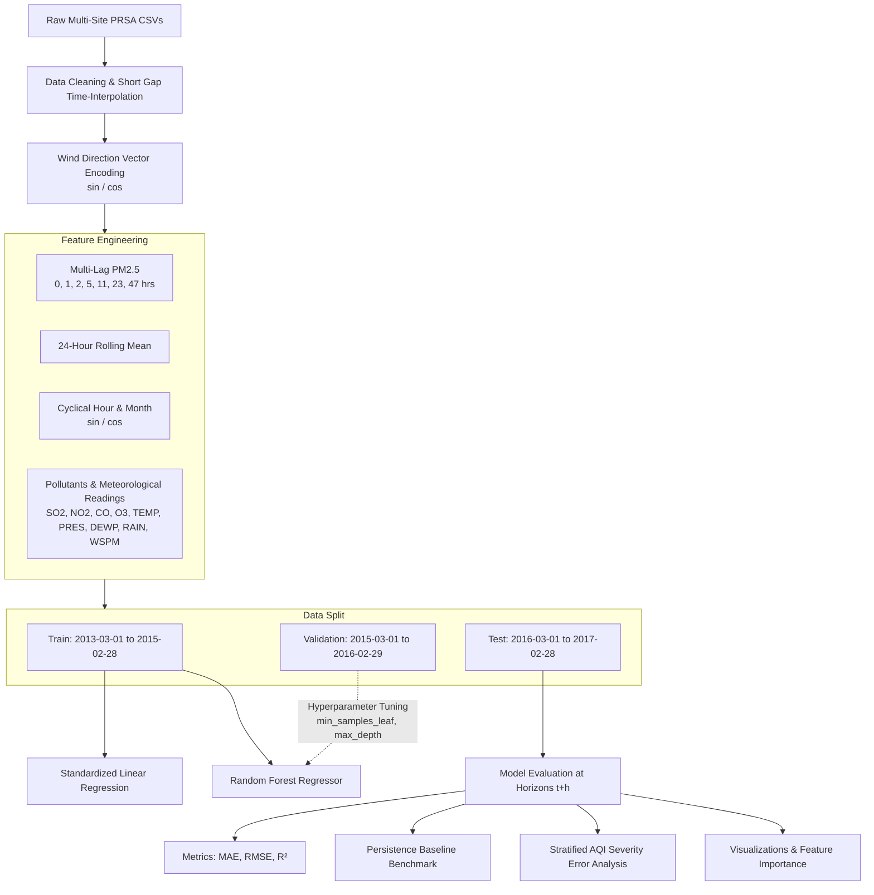
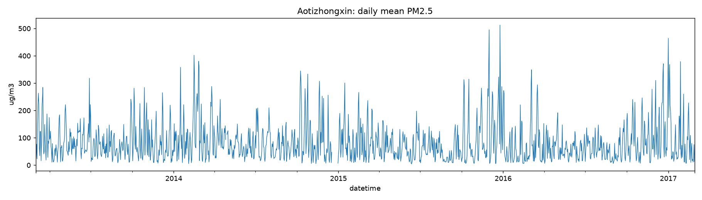
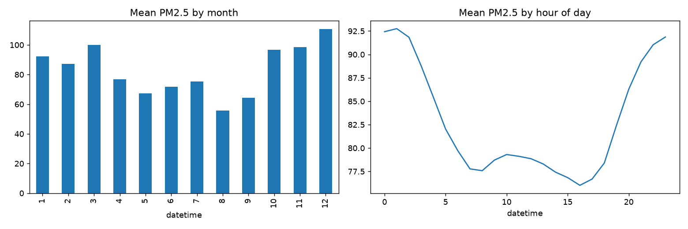
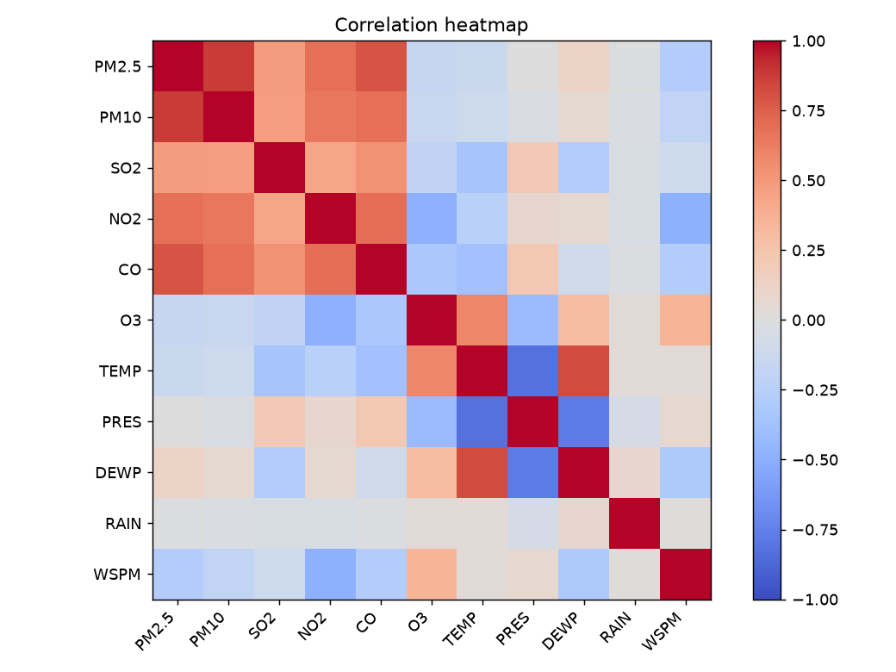
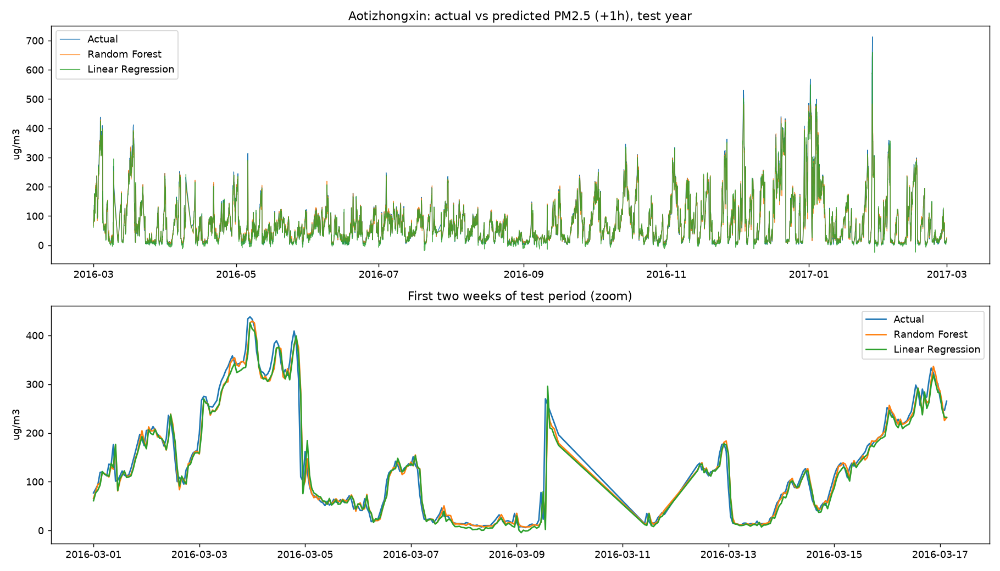
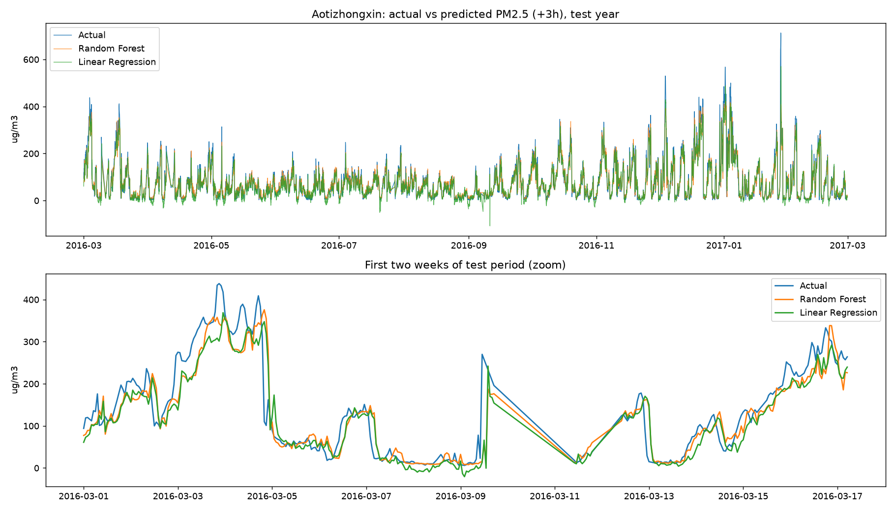
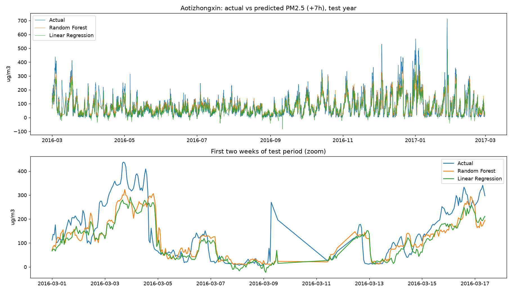
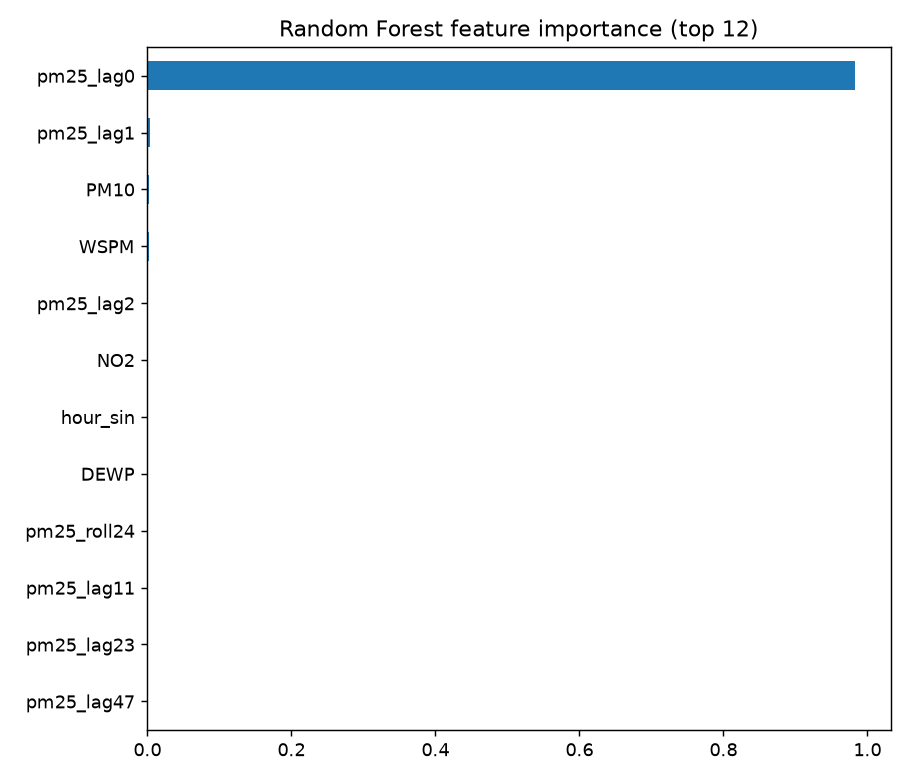

# 🌫️ Air Quality Trend Predictor

[](https://www.python.org/)
[](https://scikit-learn.org/)
[](https://pandas.pydata.org/)
[](https://numpy.org/)
[](LICENSE)
[-lightgrey)](https://archive.ics.uci.edu/ml/datasets/Beijing+Multi-Site+Air-Quality+Data)

> **Multi-horizon atmospheric particulate matter ($PM_{2.5}$) forecasting and diagnostic trend analysis across 12 Beijing monitoring stations using machine learning and meteorological feature engineering.**

---

## 📋 Table of Contents

- [Overview](#-overview)
- [Key Features](#-key-features)
- [System Architecture](#-system-architecture)
- [Dataset & Monitoring Stations](#-dataset--monitoring-stations)
- [Methodology & Feature Engineering](#-methodology--feature-engineering)
- [Experimental Results](#-experimental-results)
- [Visualizations Gallery](#-visualizations-gallery)
- [Repository Structure](#-repository-structure)
- [Installation & Quick Start](#-installation--quick-start)
- [CLI Reference & Usage](#-cli-reference--usage)
- [Error & Failure Analysis](#-error--failure-analysis)
- [Roadmap](#-roadmap)
- [Citation & References](#-citation--references)
- [License](#-license)

---

## 🌟 Overview

Particulate Matter ($PM_{2.5}$) represents fine inhalable particles with diameters 2.5 micrometers and smaller. These microscopic particles pose significant cardiovascular and respiratory health risks worldwide. Due to complex non-linear atmospheric interactions, wind dynamics, and seasonal weather patterns, predicting $PM_{2.5}$ trends is a challenging time-series regression task.

**Air Quality Trend Predictor** is an end-to-end machine learning pipeline built on the multi-site Beijing air-quality records (2013–2017). It formulates $PM_{2.5}$ forecasting across configurable future lead times (e.g., $+1\text{h}$, $+3\text{h}$, $+7\text{h}$, $+24\text{h}$), applying chronological validation, physics-informed circular encoding, multi-lag temporal dynamics, and model benchmarking against naive persistence.

---

## 🚀 Key Features

- **Multi-Horizon Forecasting**: Seamlessly evaluate short-term ($t+1\text{h}$) to medium-term ($t+7\text{h}$, $t+24\text{h}$) lead times from a single command-line interface.
- **Strict Leak-Free Temporal Splitting**: Respects chronological order with 2 years for training, 1 year for validation/hyperparameter tuning, and 1 full year for testing to prevent temporal lookahead leakage.
- **Physics-Informed Feature Engineering**:
  - **Wind Vector Decomposition**: Converts 16-point compass directions into continuous Cartesian $\sin$ and $\cos$ projections.
  - **Cyclical Diurnal & Seasonal Embeddings**: Trigonometric encoding of hour-of-day and month-of-year.
  - **Multi-Scale Autoregressive Lags**: Captures immediate and delayed historical effects at $t-0, t-1, t-2, t-5, t-11, t-23, t-47$ hours.
  - **Rolling Window Dynamics**: 24-hour moving average capturing cumulative atmospheric accumulation.
  - **Controlled Gap Imputation**: Time-based interpolation strictly restricted to short gaps ($\le 6$ hours) to preserve real data variance.
- **Competitive Model Benchmarking**:
  - **Persistence Baseline**: The classic naive standard ($y_{t+h} = y_t$).
  - **Standardized Linear Regression**: L2-normalized linear baseline.
  - **Tuned Random Forest Regressor**: Hyperparameter-optimized forest chosen purely on the validation partition.
- **Diagnostic Error & Failure Analysis**:
  - Categorical error evaluation across WHO/AQI air quality concentration bands ($0\text{--}35$, $35\text{--}75$, $75\text{--}150$, $150\text{--}250$, $250+\ \mu\text{g/m}^3$).
  - Seasonal breakdown isolating winter haze episodes vs. summer atmospheric cleansing.
- **Automated Visualization Engine**: Generates publication-ready figures for EDA, correlation matrices, feature importances, and actual vs. predicted timelines.

---

## 🏗️ System Architecture



---

## 📊 Dataset & Monitoring Stations

The dataset encompasses hourly atmospheric and meteorological readings from March 1, 2013 to February 28, 2017 (35,064 records per station) collected by Beijing Municipal Environmental Monitoring Center:

### 12 Monitoring Stations Available in `data/`
| Station Name | Geographic / Urban Context | File Name |
| :--- | :--- | :--- |
| **Aotizhongxin** *(Default)* | Olympic Sports Center, Urban North | `PRSA_Data_Aotizhongxin_20130301-20170228.csv` |
| **Changping** | Suburb Northwest | `PRSA_Data_Changping_20130301-20170228.csv` |
| **Dingling** | Ming Tombs / Rural Baseline | `PRSA_Data_Dingling_20130301-20170228.csv` |
| **Dongsi** | Central Urban / Commercial | `PRSA_Data_Dongsi_20130301-20170228.csv` |
| **Guanyuan** | Urban West Central | `PRSA_Data_Guanyuan_20130301-20170228.csv` |
| **Gucheng** | Western Industrial Corridor | `PRSA_Data_Gucheng_20130301-20170228.csv` |
| **Huairou** | Mountainous Northeast Suburb | `PRSA_Data_Huairou_20130301-20170228.csv` |
| **Nongzhanguan** | Agricultural Exhibition Hall / East | `PRSA_Data_Nongzhanguan_20130301-20170228.csv` |
| **Shunyi** | Northeast Suburb / Airport | `PRSA_Data_Shunyi_20130301-20170228.csv` |
| **Tiantan** | Temple of Heaven / Southern Core | `PRSA_Data_Tiantan_20130301-20170228.csv` |
| **Wanliu** | Northwest Haidian / Academic Zone | `PRSA_Data_Wanliu_20130301-20170228.csv` |
| **Wanshouxigong** | Southwest Core / Residential | `PRSA_Data_Wanshouxigong_20130301-20170228.csv` |

### Measured Variables
- **Target Variable**:
  - `PM2.5`: Fine particulate concentration ($\mu\text{g/m}^3$)
- **Co-Pollutants**:
  - `PM10` ($\mu\text{g/m}^3$), `SO2` ($\mu\text{g/m}^3$), `NO2` ($\mu\text{g/m}^3$), `CO` ($\mu\text{g/m}^3$), `O3` ($\mu\text{g/m}^3$)
- **Meteorological Indicators**:
  - `TEMP`: Ambient Temperature (°C)
  - `PRES`: Atmospheric Surface Pressure (hPa)
  - `DEWP`: Dew Point Temperature (°C)
  - `RAIN`: Hourly Precipitation (mm)
  - `WSPM`: Wind Speed (m/s)
  - `wd`: 16-point Compass Wind Direction (`N`, `NNE`, `NE`, `ENE`, `E`, etc.)

---

## 🔬 Methodology & Feature Engineering

### 1. Leakage-Free Temporal Partition
Time series models must never be evaluated with random K-fold splits due to temporal autocorrelation. This project uses fixed chronological splits:
$$\text{Train (24 months)} \longrightarrow \text{Validation (12 months)} \longrightarrow \text{Test (12 months)}$$

### 2. Trigonometric Cyclical Transformations
Time of day and month of year follow periodic cycles where $23\text{h}$ is adjacent to $0\text{h}$, and December ($12$) is adjacent to January ($1$):
$$\text{hour}_{\sin} = \sin\left(\frac{2\pi \cdot \text{hour}}{24}\right), \quad \text{hour}_{\cos} = \cos\left(\frac{2\pi \cdot \text{hour}}{24}\right)$$
$$\text{mon}_{\sin} = \sin\left(\frac{2\pi \cdot \text{month}}{12}\right), \quad \text{mon}_{\cos} = \cos\left(\frac{2\pi \cdot \text{month}}{12}\right)$$

### 3. Continuous Wind Direction Encoding
Wind direction is mapped from 16 discrete compass points ($0^\circ$ to $337.5^\circ$) into unit circle vector coordinates:
$$\text{wd}_{\sin} = \sin(\theta), \quad \text{wd}_{\cos} = \cos(\theta)$$

### 4. Autoregressive Temporal Lags & Accumulation
To model the atmospheric memory effect without future leakage, the feature vector includes:
- Immediate and historical lags: $PM_{2.5}(t-0), PM_{2.5}(t-1), PM_{2.5}(t-2), PM_{2.5}(t-5), PM_{2.5}(t-11), PM_{2.5}(t-23), PM_{2.5}(t-47)$
- Cumulative 24-hour moving average: $\text{roll}_{24}(PM_{2.5})$

---

## 📈 Experimental Results

Evaluated on the untouched **1-year test period** (March 1, 2016 – February 28, 2017) at the **Aotizhongxin** station across three forecast horizons ($+1\text{h}$, $+3\text{h}$, and $+7\text{h}$):

| Horizon ($t+h$) | Model | MAE ($\mu\text{g/m}^3$) | RMSE ($\mu\text{g/m}^3$) | $R^2$ Score | Performance Summary |
| :---: | :--- | :---: | :---: | :---: | :--- |
| **+1 Hour** | **Random Forest** | **9.978** | **18.598** | **0.951** | ⭐ **Best overall MAE** ($< 10\ \mu\text{g/m}^3$) |
| +1 Hour | Linear Regression | 10.497 | 18.139 | 0.954 | Competitive baseline with low latency |
| +1 Hour | Persistence | 10.373 | 19.179 | 0.948 | Strong near-term inertia benchmark |
| **+3 Hours** | **Random Forest** | **21.137** | **36.840** | **0.809** | ⭐ **Highest accuracy ($R^2 > 0.80$)** |
| +3 Hours | Linear Regression | 23.130 | 37.497 | 0.802 | Moderate degradation |
| +3 Hours | Persistence | 22.058 | 39.018 | 0.786 | Outperformed by machine learning |
| **+7 Hours** | **Random Forest** | **33.786** | **53.824** | **0.593** | ⭐ **$11.6\ \mu\text{g/m}^3$ better RMSE than naive** |
| +7 Hours | Linear Regression | 35.866 | 55.424 | 0.569 | Captures broad diurnal trend |
| +7 Hours | Persistence | 36.051 | 60.051 | 0.494 | Deteriorates significantly ($R^2 < 0.50$) |

> **Key Finding**: While the persistence heuristic performs well at $t+1\text{h}$ due to atmospheric inertia, its error degrades sharply as the horizon extends. At $+7\text{h}$, Random Forest reduces RMSE from $60.05$ to $53.82\ \mu\text{g/m}^3$ and boosts $R^2$ from $0.494$ to $0.593$, demonstrating strong non-linear pattern capture.

---

## 🖼️ Visualizations Gallery

All figures are automatically generated and saved to the `figures/` directory during execution:

### 1. Long-Term $PM_{2.5}$ Trend (4-Year Daily Mean)
Captures persistent seasonal spikes during winter heating months and cleaner summer patterns:


### 2. Seasonal & Diurnal Patterns
Reveals peak concentrations in December–February and diurnal bimodal curves driven by traffic rush hours and temperature inversions:


### 3. Atmospheric Correlation Matrix
Examines correlations between $PM_{2.5}$, particulate matter ($PM_{10}$), gaseous emissions ($SO_2, NO_2, CO$), temperature, and wind speed:


### 4. Test Year Actual vs. Predicted Timelines (+1h Horizon)
Top pane displays the entire 1-year test period; bottom pane provides a 14-day high-resolution zoom:


### 5. Multi-Horizon Forecasts (+3h and +7h)
<details>
<summary><b>Click to expand +3h and +7h Actual vs. Predicted curves</b></summary>

#### Horizon +3h


#### Horizon +7h


</details>

### 6. Feature Importance (Random Forest)
Shows the top 12 predictive features driving model decisions, dominated by recent lags ($t-0, t-1, t-2$), 24h rolling average, and meteorological drivers ($TEMP, DEWP, PRES$):


---

## 📁 Repository Structure

```text
Air-Quality-Trend-Predictor/
├── data/                                             # 12 Beijing PRSA monitoring station datasets
│   ├── PRSA_Data_Aotizhongxin_20130301-20170228.csv
│   ├── PRSA_Data_Changping_20130301-20170228.csv
│   ├── PRSA_Data_Dingling_20130301-20170228.csv
│   ├── PRSA_Data_Dongsi_20130301-20170228.csv
│   ├── PRSA_Data_Guanyuan_20130301-20170228.csv
│   ├── PRSA_Data_Gucheng_20130301-20170228.csv
│   ├── PRSA_Data_Huairou_20130301-20170228.csv
│   ├── PRSA_Data_Nongzhanguan_20130301-20170228.csv
│   ├── PRSA_Data_Shunyi_20130301-20170228.csv
│   ├── PRSA_Data_Tiantan_20130301-20170228.csv
│   ├── PRSA_Data_Wanliu_20130301-20170228.csv
│   └── PRSA_Data_Wanshouxigong_20130301-20170228.csv
├── figures/                                          # Automatically generated plots
│   ├── 01_pm25_over_time.png
│   ├── 02_seasonal_daily_patterns.png
│   ├── 03_correlation.png
│   ├── 04_actual_vs_pred_h1.png
│   ├── 04_actual_vs_pred_h3.png
│   ├── 04_actual_vs_pred_h7.png
│   └── 05_feature_importance.png
├── results/                                          # Model evaluation benchmarks
│   └── metrics.csv
├── air_quality_predictor.py                          # Core pipeline & model execution script
├── Command                                           # Reference CLI invocation command
├── requirements.txt                                  # Dependency specifications
├── .gitignore
└── README.md                                         # Project documentation
```

---

## ⚙️ Installation & Quick Start

### 1. Prerequisites
- Python 3.8 or higher installed on your system.
- Git.

### 2. Clone Repository
```bash
git clone https://github.com/SadhaSri697/Air-Quality-Trend-Predictor.git
cd Air-Quality-Trend-Predictor
```

### 3. Create a Virtual Environment
```bash
# On macOS / Linux:
python3 -m venv .venv
source .venv/bin/activate

# On Windows:
python -m venv .venv
.venv\Scripts\activate
```

### 4. Install Dependencies
```bash
pip install -r requirements.txt
```

### 5. Run the Predictor Pipeline
```bash
python air_quality_predictor.py --data data --station Aotizhongxin --horizons 1 3 7
```

All summary metrics are written to `results/metrics.csv` and visualization charts are saved to `figures/`.

---

## 💻 CLI Reference & Usage

The script `air_quality_predictor.py` provides flexible command-line arguments:

```bash
python air_quality_predictor.py [-h] --data DATA [--station STATION] [--horizons HORIZONS [HORIZONS ...]]
```

### Options & Arguments
| Parameter | Type | Default | Description |
| :--- | :---: | :---: | :--- |
| `--data` | `str` | *(Required)* | Path to the directory containing `PRSA_Data_*.csv` files. |
| `--station` | `str` | `Aotizhongxin` | Name of the monitoring station (e.g., `Tiantan`, `Wanliu`, `Huairou`). |
| `--horizons` | `int ...` | `1 6 24` | Space-separated list of forecast lead times in hours (e.g., `1 3 7`). |

### Command Examples

#### Forecast +1h, +3h, and +7h on Aotizhongxin (Standard Run)
```bash
python air_quality_predictor.py --data data --station Aotizhongxin --horizons 1 3 7
```

#### Run on a Rural / Suburban Station (Dingling)
```bash
python air_quality_predictor.py --data data --station Dingling --horizons 1 6 24
```

#### Multi-Horizon 24-Hour Forecast on Industrial Corridor (Gucheng)
```bash
python air_quality_predictor.py --data data --station Gucheng --horizons 1 12 24
```

---

## 🔍 Error & Failure Analysis

The pipeline includes built-in diagnostic routines to identify failure modes under extreme events:

### 1. Error by Pollution Severity Band
Model predictions are binned across standard environmental exposure levels:
- **Clean Air ($0\text{--}35\ \mu\text{g/m}^3$)**: Lowest absolute error ($\text{MAE} \approx 4\text{--}6\ \mu\text{g/m}^3$).
- **Severe Smog Episodes ($250+\ \mu\text{g/m}^3$)**: Machine learning models tend to exhibit a negative signed error (under-prediction). Sudden severe pollution spikes are triggered by rapid meteorological stagnations or boundary layer drops that exceed typical autoregressive variance.

### 2. Error by Season
- **Winter (Dec–Feb)**: Experiences the highest MAE due to coal/biomass heating emissions, temperature inversions, and volatile cold front dynamics.
- **Summer (Jun–Aug)**: Features significantly lower MAE and steady predictable trends due to frequent precipitation wash-out and active atmospheric mixing.

---

## 🗺️ Roadmap

- [ ] **Deep Learning Architectures**: Implement LSTM, GRU, and Temporal Fusion Transformers (TFT) for comparison.
- [ ] **Multi-Station Graph Modeling**: Spatial-temporal Graph Neural Networks (GNNs) modeling cross-station pollutant advection and wind transport.
- [ ] **Interactive Dashboard**: Streamlit / FastAPI web application for interactive station selection and real-time inference visualization.
- [ ] **Live OpenWeather API Integration**: Real-time forecast inference using current meteorological feeds.

---

## 📚 Citation & References

If you use this repository or dataset in your research or educational projects, please cite:

```bibtex
@misc{zhang2017beijing,
  title={Beijing Multi-Site Air-Quality Data Set},
  author={Zhang, Shiyi and Guo, Binyu and Dong, Ao and He, Jing and Xu, Ziping and Chen, Song Xi},
  year={2017},
  publisher={UCI Machine Learning Repository},
  note={School of Mathematical Sciences, Peking University}
}
```

---

## 📄 License

This project is licensed under the [MIT License](LICENSE) - see the LICENSE file for details.